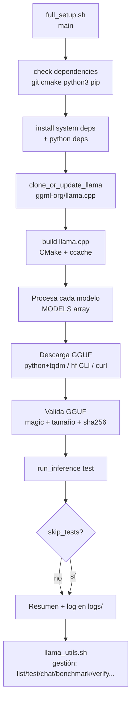

# auto-local-llm

Scripts Bash para automatizar la descarga, validación y prueba de múltiples modelos GGUF usando llama.cpp en local: setup completo multi-modelo (`full_setup.sh`), utilidades de gestión de modelos (`llama_utils.sh`), setup específico para gpt-oss-20b (`setup-gptoss.sh`) y plantilla de configuración (`config_example.sh`).

## Contenido

- [Características](#características)
- [Arquitectura](#arquitectura)
- [Stack](#stack)
- [Estructura del repositorio](#estructura-del-repositorio)
- [Instalación](#instalación)
- [Uso](#uso)
- [Configuración](#configuración)
- [Roadmap](#roadmap)
- [Licencia](#licencia)

## Características

- Descarga de múltiples modelos GGUF desde Hugging Face con tres métodos en orden de prioridad: Python + tqdm, hf CLI y curl con barra de progreso (reintentos `--retry 5`).
- Compilación de llama.cpp con CMake (`-DLLAMA_NATIVE=ON`) y `ccache` para compilación incremental.
- Instalación automática de dependencias de sistema (git, cmake, wget, ccache) y de Python (huggingface_hub, hf_transfer, tqdm).
- Validación de modelos: magic number GGUF, tamaño mínimo esperado y checksum SHA256 (opcional).
- Test de inferencia por modelo con recuperación (los fallos no detienen el resto).
- Logging con niveles (INFO/WARN/ERROR/DEBUG), colores y timestamps en `logs/`.
- Modo `dry-run`, skip de tests y control granular de rebuild/update vía variables de entorno.

## Arquitectura



## Stack

- Bash 4.4+ (scripts con `set -euo pipefail`)
- llama.cpp (compilación CMake)
- Hugging Face Hub (`huggingface_hub`, `hf_transfer`, `tqdm`)
- Python 3 (herramientas de descarga con progreso)

## Estructura del repositorio

```
auto-local-llm/
├── config_example.sh      # Plantilla de configuración (cp a .env y source)
├── full_setup.sh          # Setup multi-modelo principal (5 modelos)
├── llama_utils.sh         # Utilidades de gestión de modelos
└── setup-gptoss.sh        # Setup específico de gpt-oss-20b
```

## Instalación

Requisitos: Ubuntu 20.04+ (o distribución base Debian), Bash 4.4+, conexión a internet, ~50 GB de espacio libre y 8 GB RAM recomendados.

```bash
git clone https://github.com/bi0punk/auto-local-llm
cd auto-local-llm
chmod +x full_setup.sh setup-gptoss.sh llama_utils.sh
```

El script instala las dependencias automáticamente al ejecutarse.

## Uso

### Setup multi-modelo (5 modelos)

```bash
./full_setup.sh
```

Con token de Hugging Face (recomendado para evitar rate limits):

```bash
export HUGGING_FACE_TOKEN="hf_xxxxxxxxxxxx"
./full_setup.sh
```

Solo descargar modelos sin tests:

```bash
export SKIP_TESTS=1
./full_setup.sh
```

Simular sin ejecutar:

```bash
export DRY_RUN=1
export VERBOSE=1
./full_setup.sh
```

### Setup de gpt-oss-20b

```bash
./setup-gptoss.sh
```

### Utilidades de gestión de modelos (`llama_utils.sh`)

```bash
./llama_utils.sh list                    # lista modelos descargados
./llama_utils.sh info <modelo>           # metadatos del modelo (GGUF + sha256)
./llama_utils.sh test <modelo>           # test de inferencia
./llama_utils.sh chat <modelo>           # chat interactivo
./llama_utils.sh benchmark               # benchmark de velocidad (tokens/s)
./llama_utils.sh verify                  # verifica integridad de todos
./llama_utils.sh clean                   # limpia modelos corruptos
./llama_utils.sh sizes                   # tamaños por modelo
./llama_utils.sh remove <modelo>         # elimina un modelo
./llama_utils.sh disk-usage              # uso de disco por modelos
```

Modelos incluidos por defecto en `full_setup.sh` (Q4_K_M): gpt-oss-20b, llama-3.1-8b-instruct, mistral-7b-instruct-v0.3, qwen2.5-7b-instruct y phi-3.5-mini-instruct.

## Configuración

Variables de entorno (ver `config_example.sh`):

| Variable | Default | Descripción |
|---|---|---|
| `HUGGING_FACE_TOKEN` | *(vacío)* | Token de Hugging Face (evita rate limits) |
| `HILOS` | `nproc` | Número de threads para inferencia |
| `CTX` | `2048` | Tamaño del contexto en tokens |
| `TEMP` | `0.8` | Temperatura de generación |
| `MAX_TOKENS` | `100` | Máximo de tokens a generar |
| `FORCE_REBUILD` | `0` | Forzar recompilación de llama.cpp |
| `SKIP_GIT_PULL` | `0` | No actualizar el repositorio llama.cpp |
| `SKIP_TESTS` | `0` | Omitir tests de inferencia (solo descarga) |
| `PARALLEL_DOWNLOADS` | `1` | Descargas paralelas |
| `VERBOSE` | `0` | Modo verbose (DEBUG) |
| `DRY_RUN` | `0` | Simular sin ejecutar |

Códigos de salida: `0` éxito; `1` error general o algún modelo falló; `130` interrupción de usuario (Ctrl+C). Logs en `logs/setup_YYYYMMDD_HHMMSS.log`.

## Roadmap

- [x] Setup automático multi-modelo con validación GGUF + sha256
- [x] Utilidades de gestión (list, test, chat, benchmark, verify, clean)
- [x] Progreso visual de descarga (tqdm / hf CLI / curl)
- [ ] Soporte multi-GPU / despliegue en servidor de inferencia
- [ ] Plantillas para añadir modelos con wizard

## Licencia

Sin archivo LICENSE declarado en el repositorio.